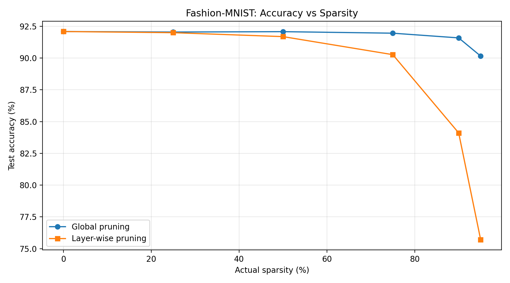
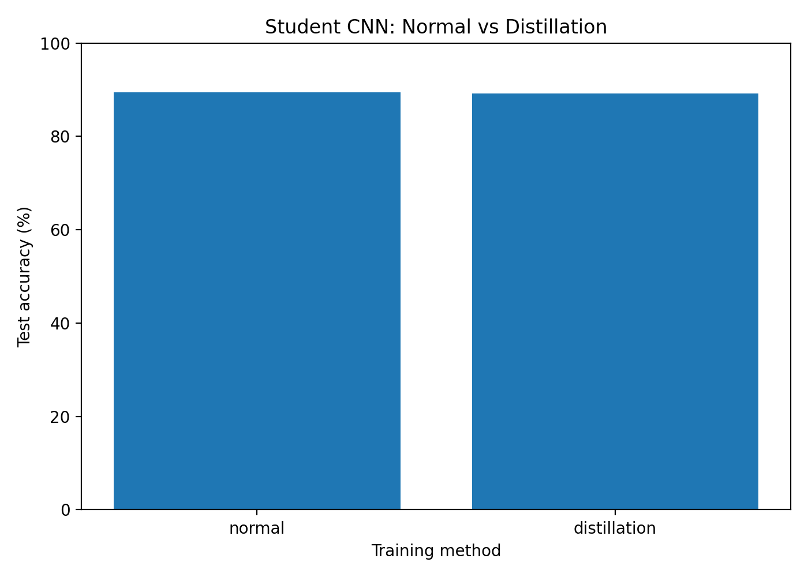
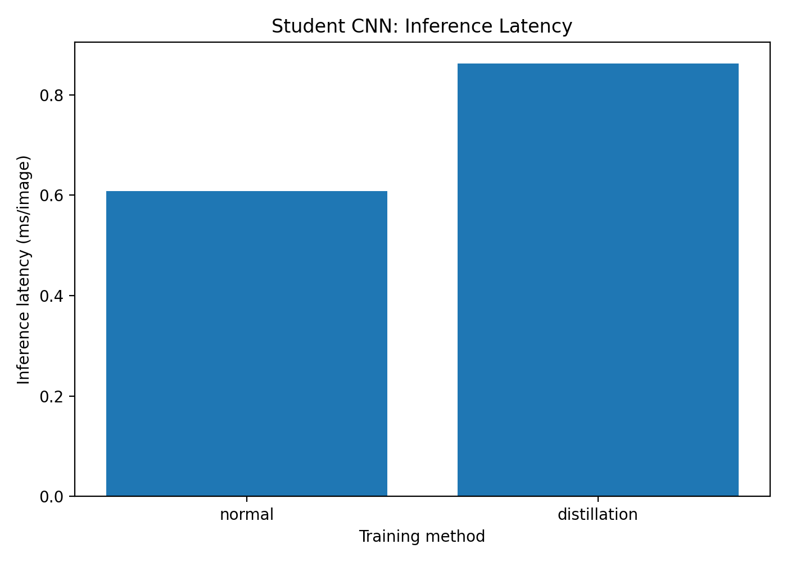

# Lab 7 — Compression: Pruning and Knowledge Distillation

**Student:** Nail Murghuzlu  
**Student ID:** 69753  
**Dataset:** Fashion-MNIST  
**Framework:** PyTorch

## 1. Objective

The purpose of this laboratory is to investigate model compression techniques and their effects on classification accuracy, model size, and inference latency.

The experiments include global magnitude pruning, layer-wise pruning, structured filter pruning, and knowledge distillation.

## 2. Baseline CNN

A convolutional neural network was trained on the Fashion-MNIST dataset.

| Metric | Result |
|---|---:|
| Test accuracy | 91.03% |
| Parameters | 824,458 |
| Model size | 3.148 MB |
| Inference latency | 0.9792 ms/image |
| Device | CPU |

The baseline provides a reference for evaluating the compressed models.

## 3. Global Magnitude Pruning

Global pruning removes weights with the smallest absolute values across the entire network.

Each pruned model was fine-tuned for three epochs while keeping its pruning mask fixed.

| Sparsity | Before fine-tuning | After fine-tuning |
|---|---:|---:|
| 0% | 91.03% | 92.09% |
| 25% | 90.98% | 92.05% |
| 50% | 90.93% | 92.08% |
| 75% | 90.80% | 91.96% |
| 90% | 82.62% | 91.59% |
| 95% | 61.46% | 90.16% |

Global pruning preserved high classification accuracy even at 90% sparsity after fine-tuning.

## 4. Layer-wise Magnitude Pruning

Layer-wise pruning removes the smallest weights independently within each layer.

| Sparsity | Before fine-tuning | After fine-tuning |
|---|---:|---:|
| 0% | 91.03% | 92.09% |
| 25% | 90.91% | 92.00% |
| 50% | 80.49% | 91.69% |
| 75% | 46.13% | 90.27% |
| 90% | 19.99% | 84.11% |
| 95% | 26.05% | 75.71% |

Global pruning performed better than layer-wise pruning at high sparsity levels.

At 90% sparsity, global pruning achieved 91.59% accuracy, compared with 84.11% for layer-wise pruning.

## 5. Structured Filter Pruning

Structured pruning removes entire convolutional filters according to their L2 norms.

| Filter pruning | Parameters | Parameter reduction | Test accuracy |
|---|---:|---:|---:|
| 10% | 745,864 | 9.53% | 90.10% |
| 25% | 615,594 | 25.33% | 82.25% |
| 50% | 409,034 | 50.39% | 76.18% |

Unlike unstructured pruning, this implementation physically reduces the network dimensions and parameter count.

The results show that aggressive filter removal significantly reduces classification accuracy without additional fine-tuning.

## 6. Knowledge Distillation

A smaller CNN containing 105,866 parameters was trained using two methods.

The first student used standard supervised learning. The second student used knowledge distillation from the baseline teacher model.

The distillation settings were:

- Temperature: T = 4
- Alpha: 0.5
- Training duration: 5 epochs

| Student method | Accuracy | Parameters | Size | Training-run latency |
|---|---:|---:|---:|---:|
| Normal training | 89.43% | 105,866 | 0.407 MB | 0.608 ms |
| Knowledge distillation | 89.15% | 105,866 | 0.407 MB | 0.862 ms |

Knowledge distillation did not improve accuracy in this experiment. The normally trained student achieved 0.28 percentage points higher accuracy.

This result suggests that the selected distillation configuration may require further tuning.

## 7. CPU Latency and Model Size

A separate CPU benchmark measured the baseline and student models under a consistent procedure.

| Model | Parameters | Serialized size | CPU latency |
|---|---:|---:|---:|
| Baseline CNN | 824,458 | 3.1479 MB | 0.8262 ms |
| Normal student | 105,866 | 0.4067 MB | 0.5637 ms |
| Distilled student | 105,866 | 0.4067 MB | 0.5346 ms |

Both student models are substantially smaller than the baseline.

The student models also showed lower average latency in this benchmark.

Latency values differ slightly from the training-run measurements because they were collected in separate benchmark runs.

## 8. Dense vs Sparse Storage

The following experiment compared serialized dense tensors with sparse COO representations.

| Sparsity | Dense size | Sparse size | CPU latency |
|---|---:|---:|---:|
| 0% | 3.1479 MB | 16.0090 MB | 0.8196 ms |
| 25% | 3.1479 MB | 12.0578 MB | 0.7095 ms |
| 50% | 3.1479 MB | 8.1042 MB | 0.9383 ms |
| 75% | 3.1479 MB | 4.1297 MB | 0.8659 ms |
| 90% | 3.147